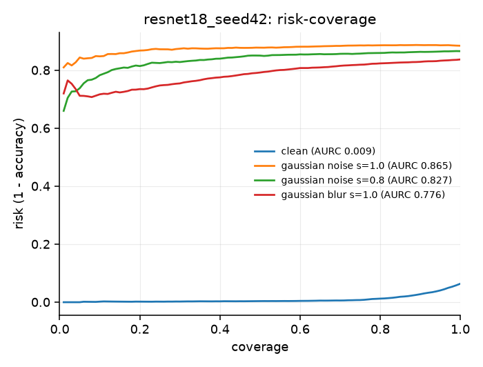

# RobustVision Lab

<sub>English | [简体中文](README.zh-CN.md)</sub>


An evaluation harness for image classifiers on CIFAR-10. Seven perturbations and
four composites, five calibrated severity levels each, run over the full 10,000
image test set. Two backbones, three seeds each.

It exists to answer four questions with numbers rather than intuition: how far
accuracy falls under each kind of shift, whether stacked perturbations behave
multiplicatively, whether confidence still tracks correctness once the input is
degraded, and whether a reject option helps when it does not.


## Results

### Baselines

| | test accuracy | ECE (15 bins) | Brier | AURC |
|---|---|---|---|---|
| ResNet18, seeds 42/43/44 | 0.9369 ± 0.0008 | 0.035 | 0.102 | 0.009 |
| ResNet50, seeds 42/43/44 | 0.9571 ± 0.0011 | 0.026 | 0.070 | 0.004 |

Brier is summed over the ten classes, so its range is 0–2 rather than the 0–1 of
the binary version.

Seed spread is under 0.12 points for both, so the differences reported below are
not one lucky initialisation. Training is plain SGD with cosine decay, 100
epochs, no tricks: 24 minutes per ResNet18 seed, about two hours per ResNet50.

### Accuracy under shift

At severity 1.0 ResNet18 lands between 0.11 and 0.31. Ascending order of damage:
gaussian noise 0.113, gaussian blur 0.165, contrast 0.205, jpeg 0.216 (quality
2), motion blur 0.217, occlusion 0.296, brightness 0.306.

Brightness and contrast follow an S-curve: almost nothing happens through the
first three levels, then the floor drops out. That is the physics of darkening a
32×32 image, not a bad severity table. JPEG bottoms out at 0.22 because quality 2
is already past the point where further compression destroys anything; quality 1
measures 0.239 on a 2,000-image probe, so the codec has nothing left to take.

Normalising each curve by its own damage separates "how much breaks" from "how
fast it breaks". Motion blur is the steepest, losing a quarter of its total
damage by s=0.2; brightness loses almost nothing before the last level.


### Composites

Sixty points per model (4 composites × 5 levels × 3 seeds), ResNet18 first.
Forty-two sit above the product of their parts, but the average hides which ones:

- `noise_blur` +0.172, range +0.103 to +0.278
- `noise_occ` +0.076, range +0.051 to +0.102
- `blur_bright` −0.000
- `triple` −0.002

Anything containing additive noise is under-predicted by the multiplicative
model; pure photometric stacks behave as if independent. The mechanism is
plausible: noise destroys the high-frequency detail that blur was going to
destroy anyway, so the second hit costs less than it would alone.

ResNet50 reproduces the ordering (+0.121, +0.055, −0.002, −0.013; 43 of 60
positive). Two models agreeing on which composite deviates and which does not is
worth more than sixty points from one model.


### Calibration

Clean ECE is 0.035, which looks fine. Under gaussian noise at s=1.0 it reaches
0.652, and the reliability curve shows the model claiming 0.9 confidence at 0.15
accuracy.


Post-hoc temperature scaling, fitted on the validation split, T=1.51: clean ECE
drops from 0.035 to 0.010, jpeg from 0.573 to 0.464, gaussian blur from 0.584 to
0.456, noise from 0.652 to 0.537. So it removes 70% of the clean miscalibration
and roughly 11 points under shift. The temperature is not wrong; the confidence
itself has stopped carrying information about correctness, and rescaling a
useless signal leaves it useless.

ResNet50 is better calibrated on clean data (0.026 → 0.007) and worse under
shift: 0.684 → 0.584 on noise, 0.612 → 0.482 on jpeg. A single seed suggested the
opposite, which is why the three-seed runs exist.

### Selective prediction

Sorting by confidence and keeping the top 80% works while the model still knows
what it does not know. Clean data: risk falls from 0.063 to 0.009. Under
gaussian noise at s=0.6 it is 0.795, and under `triple` 0.871, so rejecting one
image in five removes almost no errors. The rejected samples and the kept ones
carry near-identical confidence.



### Model size

ResNet50 starts 2 points higher and keeps a larger share of its accuracy on
average (0.267 vs 0.232 retention at s=1.0). That average comes almost entirely
from two perturbations: brightness (0.514 vs 0.327) and contrast (0.354 vs 0.219).
Drop those two rows and the ranking reverses, 0.200 against 0.215. On noise,
jpeg, motion blur and gaussian blur, ResNet50 wins nothing.


Bigger is not more robust here; it is more robust to global photometric change
and slightly less robust to losing high-frequency detail, which is what a 32×32
input has little of to begin with.

## Running it

```bash
python -m venv .venv
.venv/Scripts/activate
pip install torch torchvision --index-url https://download.pytorch.org/whl/cu128
pip install -r requirements-dev.txt

python scripts/download_data.py                                   # ~140 MB, builds data/cifar10.npz
python scripts/train.py --config configs/resnet18.yaml --seed 42   # 24 min
python scripts/train.py --config configs/resnet50.yaml --seed 42   # about 2 h
python scripts/run_experiment.py --model resnet18 --seed 42        # full grid, ~4 min
python scripts/aggregate.py                                        # cross-seed tables and figures
streamlit run app/main.py                                          # six-page UI
pytest                                                             # 67 tests
```

Training writes `outputs/checkpoints/<model>_seed<k>_last.pt` every epoch,
optimizer state included, so `--resume` picks up after a crash. That is not
decoration: ResNet50 segfaulted at epoch 74 once on Windows with
`num_workers=2`, and the re-run needed `--workers 0`.

On Windows, the default PyPI wheel for torch is CPU-only. Use the index above.

## Layout

```
configs/         training configuration
dataio/          CIFAR-10 loading and normalisation
models/          backbone construction, uniform predict_proba
perturbations/   7 single + 4 composite, severity as a lookup table
metrics/         accuracy, ECE/MCE/Brier, risk-coverage, temperature scaling
experiments/     grid sweep, aggregation, plots
app/             Streamlit UI
scripts/         download, train, experiment, aggregate
tests/           67 unit tests
docs/figures/    figures used by the READMEs
outputs/         checkpoints, cached probabilities, CSV/JSON records (gitignored)
```

Design decisions live in [PROJECT_SPEC.md](PROJECT_SPEC.md): split, severity
table, metric definitions, experiment matrix. Nothing in the code is an
undocumented convention.

## Data

CIFAR-10, not committed. `scripts/download_data.py` pulls the HuggingFace mirror
(`uoft-cs/cifar10`, parquet, via hf-mirror.com) and converts it to
`data/cifar10.npz`, 184 MB of uint8 arrays. The official tarball on
`cs.toronto.edu` measured 90 KB/s from this machine, thirty minutes for 170 MB,
which made training wait on a download.

Consequence: `dataio.CifarArray` replaces `torchvision.datasets.CIFAR10`, so
there is no pickle layer and no download on import. The arrays are the same
images. Outside mainland China you can restore the official tarball instead.

## Limitations

- Severity anchors were picked by eye, then adjusted once against measured
  accuracy. CIFAR-10-C's severity table went through far more validation.
- Temperature is fitted on the clean validation split, one scalar for every
  condition. Fitting per condition would look better and would be tuning on test
  data.
- Photometric perturbations have large seed spread at the last level (std 0.051
  for contrast, 0.035 for brightness) against 0.002–0.003 for jpeg and motion
  blur. Read those two rows with the spread in mind.
- Perturbations run on the model's device, but the RNG draws on CPU so the same
  seed gives the same corruption on any device. `jpeg` still round-trips through
  CPU because torchvision 0.26 has no batched JPEG path; it is the slowest
  condition in the grid.

## License

MIT.
