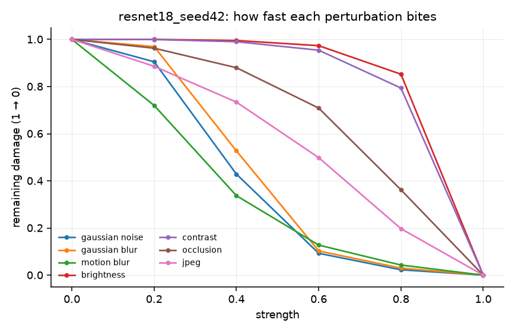
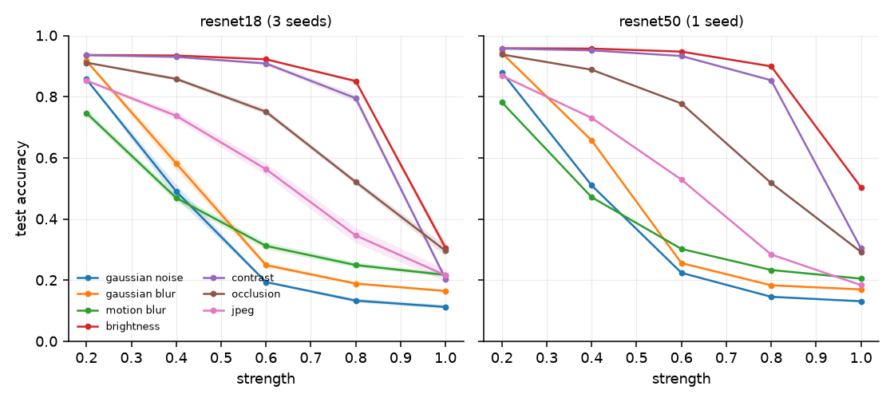
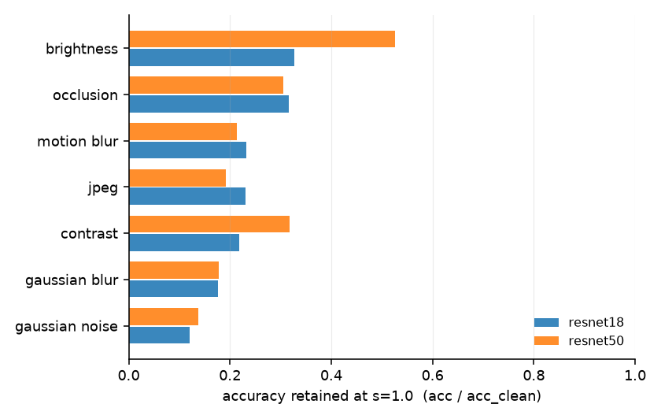

# RobustVision Lab

视觉模型鲁棒性、置信度校准与选择性预测的评估平台。

四个问题，CIFAR-10 test 集 10000 张，ResNet18 三个种子 + ResNet50 一个：

- RQ1 图像分布偏移下模型性能怎么变
- RQ2 复合扰动与单一扰动的关系是不是乘性的
- RQ3 模型置信度能否反映真实正确率
- RQ4 低置信度时拒绝预测能否降低错误风险

> 主仓库：https://github.com/Chenqr06/RobustVision-Lab

设计细节在 [PROJECT_SPEC.md](PROJECT_SPEC.md)：数据集划分、扰动参数表、指标定义、实验矩阵。


## 状态

| 模块 | 状态 |
|---|---|
| 数据 / 模型 / 训练 | ResNet18 × 3 种子、ResNet50 × 1，均 100 epoch |
| 扰动（7 单一 + 4 复合） | 完成，参数逐档标定 |
| 指标（Acc / ECE / MCE / Brier / AURC） | 完成 |
| 实验 E1–E7 | 完成 |
| Streamlit 平台（6 页） | 完成 |
| 测试 | 66 个，全过 |

## 结果

### 基线

| 模型 | 种子 | test accuracy | ECE | AURC |
|---|---|---|---|---|
| ResNet18 | 42 / 43 / 44 | **0.9369 ± 0.0008** | 0.0354 | 0.0087 |
| ResNet50 | 42 | **0.9581** | 0.0252 | 0.0035 |

ResNet18 的三个种子只差 0.08 个百分点，说明后面所有结论都不是靠某一次幸运初始化撑起来的。
ResNet50 高 2.1 个点，校准也更好——但只有一个种子，它的方差未知。

训练配方一样（SGD、cosine、100 epoch），只有 ResNet50 慢得多：68 s/epoch，单卡跑完接近 2 小时。

### RQ1 单扰动：最狠的能掉到 0.11

三种子平均，绝大多数点的标准差小于 0.01，最大 0.026（jpeg s=0.8）：

| 扰动 | s=0.2 | 0.4 | 0.6 | 0.8 | s=1.0 |
|---|---|---|---|---|---|
| gaussian_noise | 0.857 | 0.490 | 0.194 | 0.133 | **0.113** |
| gaussian_blur | 0.917 | 0.582 | 0.249 | 0.189 | 0.165 |
| motion_blur | 0.747 | 0.469 | 0.312 | 0.250 | 0.217 |
| contrast | 0.936 | 0.930 | 0.909 | 0.795 | 0.205 |
| occlusion | 0.911 | 0.858 | 0.751 | 0.521 | 0.296 |
| brightness | 0.936 | 0.935 | 0.922 | 0.851 | 0.306 |
| jpeg | 0.853 | 0.738 | 0.563 | 0.346 | 0.216 |

干净 0.937。s=1.0 时七种扰动落在 **0.11–0.31**，已经没有掉队的了。

亮度、对比度是 **S 型**曲线：前几档几乎不动，最后一档才崩。不是标定没做好，
是物理事实——把图暗到 62% 模型照样认得出，暗到 16% 就不行了。

每种扰动的绝对破坏力不同，直接比 s=1.0 的准确率意义有限。按各自损失归一化后看**下降速度**：



motion blur 最陡，s=0.2 就吃掉 30% 的总损失；brightness 最缓。

### 模型对比：ResNet50 干净数据更强，但鲁棒性只赢一面

两个模型的干净基线不同（0.937 vs 0.958），所以下表除了 s=1.0 的准确率，还给了
**保持率**（除以各自的干净准确率）。绝对准确率混了基线差异进去，保持率才是纯粹的抗破坏能力。

| 扰动 | R18 acc | R18 保持率 | R50 acc | R50 保持率 |
|---|---|---|---|---|
| brightness | 0.306 | 0.327 | **0.504** | **0.526** |
| contrast | 0.205 | 0.219 | **0.304** | **0.318** |
| gaussian_blur | 0.165 | 0.176 | **0.170** | **0.177** |
| gaussian_noise | 0.113 | 0.120 | **0.131** | **0.137** |
| occlusion | **0.296** | **0.316** | 0.293 | 0.305 |
| motion_blur | **0.217** | **0.232** | 0.205 | 0.214 |
| jpeg | **0.216** | **0.231** | 0.184 | 0.192 |
| 平均 | | 0.232 | | **0.267** |




4 赢 3 输，平均保持率高出 3.5 个百分点。但这个平均几乎全是 brightness 一个点撑起来的
（0.526 vs 0.327）：去掉它之后是 0.216 对 0.224，基本打平。

分得挺清楚：**对光度类扰动和遮挡，多出来的容量确实有用**；对破坏高频细节的三种
（jpeg、motion blur、gaussian blur），ResNet50 一个都没赢，jpeg 的保持率低了近 4 个百分点。
合理的解释是 CIFAR 的 32×32 图像里高频信息本来就少，ResNet50 那套更深的降采样在干净的
大图上有效，在这里反而把仅剩的细节丢得更彻底——但这只是解释，没做消融验证。

所以"更大的模型更鲁棒"这句话在这里不成立，得说清楚是对哪类扰动。

### RQ2 复合扰动：只有含噪声的才是非乘性的

60 个点（4 种复合 × 5 强度 × 3 种子）里 42 个实测高于"各成员准确率相乘"，平均高 0.061。
拆开看，结论不是一句"非乘性"能概括的：

| 复合 | 平均 gap | 范围 | 判读 |
|---|---|---|---|
| `noise_blur` | **+0.172** | +0.103 ~ +0.278 | 明显高于乘积 |
| `noise_occ` | +0.076 | +0.051 ~ +0.102 | 稳定高于乘积 |
| `blur_bright` | -0.000 | -0.071 ~ +0.059 | 基本等于乘积 |
| `triple` | -0.002 | -0.105 ~ +0.108 | 基本等于乘积 |


含加性噪声的复合被乘性模型高估，纯光度扰动（亮 + 对比 + 模糊）几乎就是独立的。
解释得通：噪声吃掉的细节，模糊本来也会吃掉，两次损伤重叠，联合效果小于各自相乘。

所以"复合比单扰动之和更糟"这个常见说法在这里只对了一半——噪声参与的场合乘性模型不成立，
其余情况它反而够用。分辨出这个差别比笼统下结论有用。

### RQ3 校准：干净数据还行，扰动下彻底失效


干净 ECE 0.035，看着不错。加噪声到 s=1.0 涨到 0.65。可靠性图上那条红线（噪声）在
置信度 0.9 处实际准确率只剩 0.15 —— 模型在完全瞎猜的时候依然很自信。

（图是 seed 42 跑的，表里是三个种子的均值，数字略有出入但结论一致。）

加了 post-hoc 温度缩放作基线，每个种子在验证集上各拟合一次，T ≈ 1.51：

| 条件 | ECE 原始 | ECE 校准后 |
|---|---|---|
| clean | 0.035 | **0.010** |
| jpeg s=1.0 | 0.573 | 0.464 |
| gaussian_blur s=1.0 | 0.584 | 0.456 |
| gaussian_noise s=1.0 | **0.652** | **0.537** |

干净数据修掉了 70% 的校准误差，扰动条件下只修掉 11–13 个百分点。
**一个标量温度救不了分布偏移下的过度自信**——问题不是温度调错了，是置信度在这些输入上
本来就失去了信息量。

ResNet50 的校准整体更好一点（T = 1.61）：干净 ECE 0.025 → 0.007，噪声条件下 0.486 → 0.365，
比 ResNet18 的 0.652 → 0.537 好一截。唯一反超的是 jpeg（0.612 → 0.481，比 ResNet18 差），
和它在 jpeg 上准确率更低是同一件事。

### RQ4 选择性预测：救得了干净数据，救不了崩掉的输入


| 条件（s=0.6） | 准确率 | risk@80% | risk@90% |
|---|---|---|---|
| clean | 0.937 | 0.009 | — |
| brightness | 0.922 | 0.017 | 0.037 |
| contrast | 0.909 | 0.023 | 0.047 |
| occlusion | 0.751 | 0.164 | 0.205 |
| jpeg | 0.563 | 0.373 | 0.405 |
| motion_blur | 0.312 | 0.663 | 0.674 |
| gaussian_blur | 0.249 | 0.734 | 0.742 |
| gaussian_noise | 0.194 | 0.795 | 0.800 |
| triple | 0.130 | **0.871** | 0.871 |

干净数据下拒绝 20% 的最低置信样本，风险从 6.3% 降到 0.9%，很有效。
但 triple 条件下拒绝 20% 之后仍有 87% 的错误率——被拒掉的和留下的置信度差不多，
阈值在这个区间没有区分能力。

## 跑起来

```bash
python -m venv .venv
.venv/Scripts/activate
pip install torch torchvision --index-url https://download.pytorch.org/whl/cu128
pip install -r requirements-dev.txt

python scripts/download_data.py                                   # 下载并转 npz
python scripts/train.py --config configs/resnet18.yaml --seed 42  # 约 24 分钟
python scripts/train.py --config configs/resnet50.yaml --seed 42  # 约 1 小时 55 分
python scripts/run_experiment.py --model resnet18 --seed 42       # 全网格，约 4 分钟
python scripts/aggregate.py                                       # 多种子汇总 + 对比图
streamlit run app/main.py                                         # 六页界面
pytest                                                            # 66 个测试
```

训练中途断了不用从头来：每轮会写 `outputs/checkpoints/<model>_seed<k>_last.pt`（含优化器和
调度器状态），加 `--resume` 接着跑。这不是为了好看——ResNet50 用 `num_workers=2` 跑时在第 74
轮段错误崩过一次，换成 `--workers 0` 重训才跑满 100 轮。

Windows 上 pypi 默认的 torch wheel 是 CPU 版，必须走 `download.pytorch.org`。

## 目录

```
configs/        训练与实验配置
dataio/         数据加载、归一化
models/         模型构建与统一 predict_proba 接口
perturbations/  7 种单一扰动 + 4 种复合，参数逐档查表
metrics/        Accuracy / ECE / MCE / Brier / Risk–Coverage / 温度缩放
experiments/    网格扫描、指标汇总、绘图
app/            Streamlit 六页界面
scripts/        下载 / 训练 / 实验 / 汇总
tests/          66 个单元测试
docs/figures/   README 用的结果图
outputs/        结果 CSV、JSON、checkpoint，不进仓库
```

## 已知问题

- **ResNet50 只有一个种子。** 三种子的方差在 ResNet18 上是 0.0008，小得可以忽略，但这不能
  直接搬到 ResNet50 上——它的对比结论（尤其 jpeg、motion blur 那 1–2 个点的差距）都落在
  单种子的噪声范围内，别当定论看。
- `jpeg` 的 s=1.0 用 quality 2，准确率 0.216。再往下压也没有意义：quality 1 在 2000 张上
  测出来 0.239，quality 2 是 0.240，已经到底了，32×32 的图再怎么压都有这么多信息活下来。
  早期的表用 quality 8（剩 0.405），是七个扰动里唯一的离群点，后来改成现在这张表。
- 温度缩放的 T 是在干净验证集上拟合的。按每个扰动条件各自拟合会更好看，
  但那是拿测试集调参，没做。
- 强度档位按"人眼可辨"手工定，不是按等破坏力定。归一化图和保持率补了一部分，
  但比不上 CIFAR-10-C 那种经过大量人工验证的 severity 表。
- Windows 上 ResNet50 训练崩过一次（同一份代码 ResNet18 跑三次都没事，原因没查清）。
  现在 `scripts/train.py` 每轮落一个带优化器状态的 `_last.pt`，`--resume` 能从崩溃处接着跑。

## 数据集

CIFAR-10，不提交仓库。`scripts/download_data.py` 从 hf-mirror 下载 parquet 并转成本地 npz
（官方源 cs.toronto.edu 在国内实测 90 KB/s，用不了）。使用请遵守原始许可条款。

## 许可证

MIT
