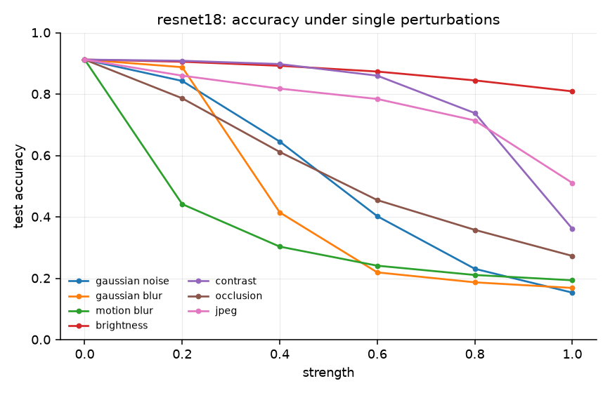
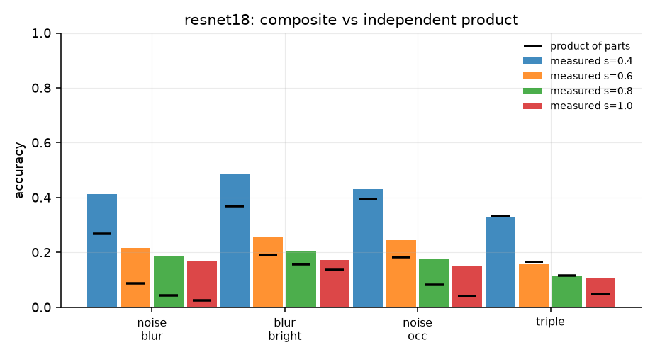
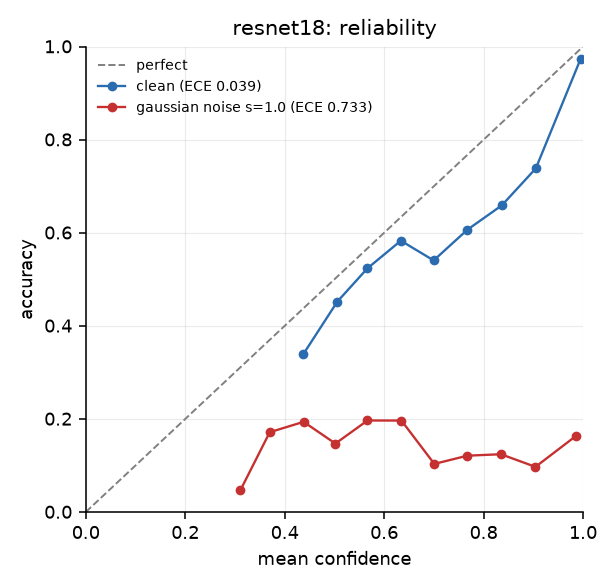

# RobustVision Lab

视觉模型鲁棒性、置信度校准与选择性预测的评估平台。

四个问题，全部用 CIFAR-10 test 集 10000 张跑过：

- RQ1 图像分布偏移下模型性能怎么变
- RQ2 复合扰动与单一扰动的关系是不是乘性的
- RQ3 模型置信度能否反映真实正确率
- RQ4 低置信度时拒绝预测能否降低错误风险

> 主仓库：https://github.com/Chenqr06/RobustVision-Lab

设计细节在 [PROJECT_SPEC.md](PROJECT_SPEC.md)：数据集划分、扰动参数、指标定义、实验矩阵。



## 状态

| 模块 | 状态 |
|---|---|
| 数据 / 模型 / 训练 | 完成，resnet18 test 0.9123 |
| 扰动（7 单一 + 4 复合） | 完成 |
| 指标（Acc / ECE / MCE / Brier / AURC） | 完成 |
| 实验 E1–E6 | 完成，结果在 `outputs/results/` |
| Streamlit 平台（6 页） | 完成 |
| 测试 | 61 个，全过 |

## 结果

### 单扰动：干净 0.9123 之后能掉到 0.15

| 扰动 | s=0.2 | s=0.6 | s=1.0 |
|---|---|---|---|
| gaussian_noise | 0.8428 | 0.4022 | **0.1532** |
| gaussian_blur | 0.8876 | 0.2192 | 0.1685 |
| motion_blur | 0.4415 | 0.2410 | 0.1935 |
| brightness | 0.9054 | 0.8734 | **0.8089** |
| contrast | 0.9085 | 0.8600 | 0.3613 |
| occlusion | 0.7863 | 0.4547 | 0.2728 |
| jpeg | 0.8600 | 0.7841 | 0.5105 |

排序很直观：加性噪声和模糊最致命，亮度几乎不影响，JPEG 压缩到 quality=10 还剩一半。

亮度为什么这么稳：`factor = 1 + 0.8s` 最大只到 1.8，像素很快饱和到 1.0，模型看到的
仍然是可辨认的物体。这不是模型鲁棒，是扰动本身到顶了。

### 复合扰动不是乘性的

把复合扰动的实测准确率和"各成员单独准确率相乘"对比，20 个点里有 17 个实测高于乘积：



- `noise_blur` 差距最大，5 个强度上都是 +0.11 ~ +0.14
- `triple` 在 s=0.4~0.8 几乎完全吻合乘积（gap 在 ±0.01 以内）
- 只有这三处 gap 为负，其余全为正

所以拿单一扰动结果外推复合场景会偏悲观。失误模式重叠是原因之一：噪声吃掉的细节，
模糊本来也已经吃掉了，两次损伤不是独立事件。

### 置信度在分布偏移下彻底失效

干净数据 ECE 0.039，看起来校准得不错。但加噪声到 s=1.0，ECE 涨到 **0.733**：



红色那条线最能说明问题：模型给出 0.9 的置信度时，实际准确率只有 0.13。
它不是"知道自己不确定"，而是在完全瞎猜的时候依然很自信。

### 选择性预测救得了干净数据，救不了崩掉的输入


| 条件 | 准确率 | risk@80% | risk@90% | AURC |
|---|---|---|---|---|
| clean | 0.9123 | 0.0194 | 0.0446 | 0.0121 |
| gaussian_blur s=1.0 | 0.1685 | 0.7621 | 0.7726 | 0.787 |
| gaussian_noise s=1.0 | 0.1532 | 0.5646 | 0.5800 | 0.783 |
| triple s=0.6 | 0.1561 | 0.8378 | 0.8412 | — |

干净数据下拒绝 20% 的最低置信样本，风险从 8.8% 降到 1.9%，很有效。
但扰动到 0.17 准确率时，拒绝 20% 之后仍然是 76% 的错误率——因为剩下的样本置信度
同样高，只是都错了。置信度阈值在这种条件下没有区分能力。

## 跑起来

```bash
python -m venv .venv
.venv/Scripts/activate
pip install torch torchvision --index-url https://download.pytorch.org/whl/cu128
pip install -r requirements-dev.txt

python scripts/download_data.py                                   # 下载并转 npz
python scripts/train.py --config configs/resnet18.yaml            # 40 epoch，约 10 分钟
python scripts/run_experiment.py --model resnet18                 # 全网格，约 5 分钟
streamlit run app/main.py                                         # 六页界面
pytest                                                            # 61 个测试
```

Windows 上 pypi 默认的 torch wheel 是 CPU 版，必须走 `download.pytorch.org`。

## 目录

```
configs/        训练与实验配置
dataio/         数据加载、归一化
models/         模型构建与统一 predict_proba 接口
perturbations/  7 种单一扰动 + 4 种复合
metrics/        Accuracy / ECE / MCE / Brier / Risk–Coverage / AURC
experiments/    网格扫描、指标汇总、绘图
app/            Streamlit 六页界面
scripts/        下载 / 训练 / 评估 / 实验
tests/          61 个单元测试
docs/figures/   README 用的结果图
outputs/        结果 CSV、JSON、checkpoint，不进仓库
```

## 已知问题

- **跨扰动的强度轴不能直接比。** `motion_blur` 的核长从 5 起步，s=0.2 就掉了 47 个点，
  而 `gaussian_blur` 在 0.2 只掉 2.5 个点。两条线放在同一张图上，低强度段不公平。
  要做横向比较，得先按 CIFAR-10-C 的做法给每种扰动单独校准 severity。
- **只有 resnet18，单种子。** 最终表格本应用 42/43/44 三个种子，现在只有 42。
- **没有温度缩放基线。** 校准部分只报了原始模型的 ECE，没做 post-hoc 对比。
- 干净数据 0.9123 低于 CIFAR-10 上常见的 0.95，因为只训了 40 epoch。

## 数据集

CIFAR-10，不提交仓库。`scripts/download_data.py` 从 hf-mirror 下载 parquet 并转成本地 npz
（官方源 cs.toronto.edu 在国内实测 90 KB/s，用不了）。使用请遵守原始许可条款。

## 许可证

MIT
