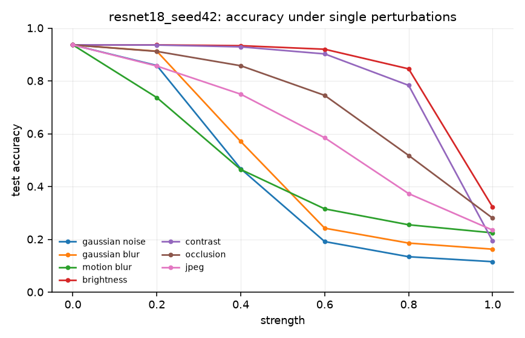
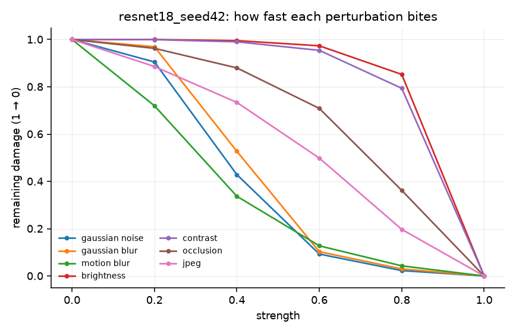
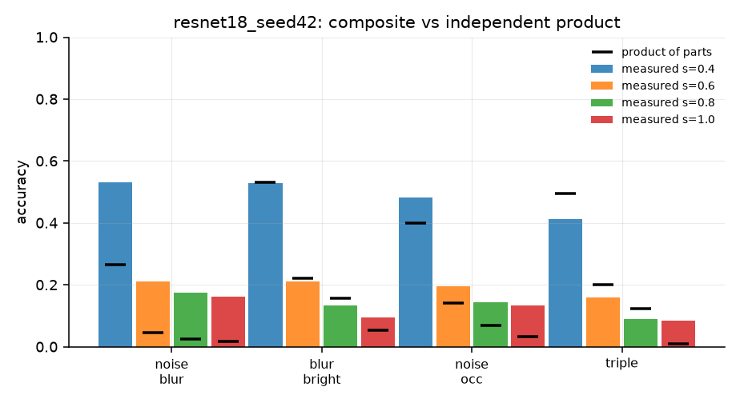
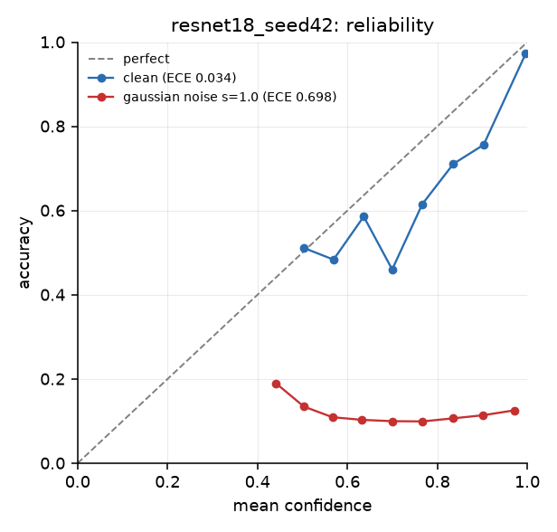
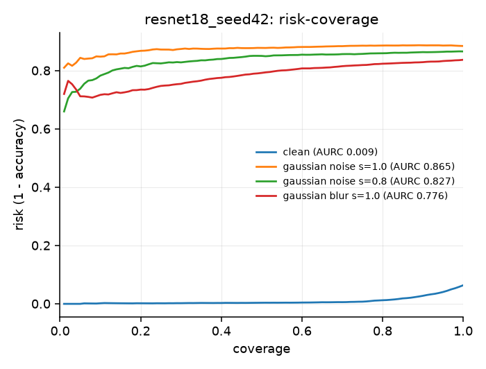
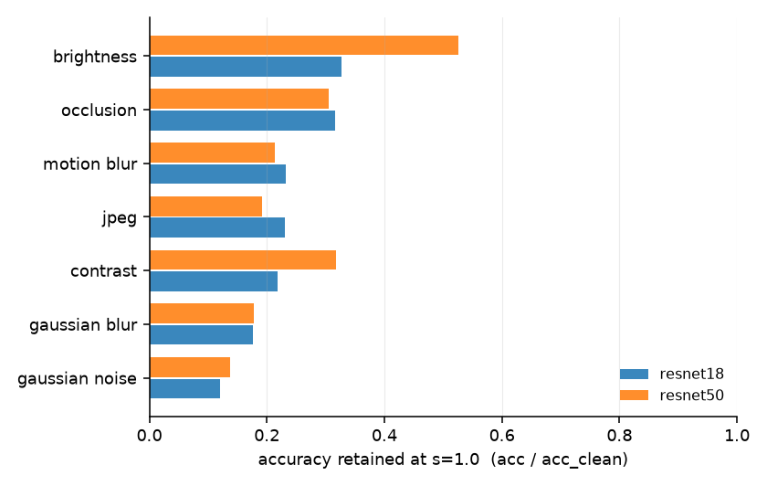

# RobustVision Lab

<sub>[English](README.md) | 简体中文</sub>


CIFAR-10 上的一套评估工具。七种单一扰动加四种复合扰动，每种五档强度，全部跑满
10000 张测试图。两个主干，各三个种子。

搭它是为了把四件事从"感觉"变成"数字"：每种偏移下准确率掉多少、几种扰动叠起来
是不是等于各自相乘、图糊了以后置信度还能不能反映对错、以及低置信度拒绝预测
到底管不管用。



## 结果

### 基线

| | test accuracy | ECE（15 箱） | Brier | AURC |
|---|---|---|---|---|
| ResNet18，种子 42/43/44 | 0.9369 ± 0.0008 | 0.035 | 0.102 | 0.009 |
| ResNet50，种子 42/43/44 | 0.9571 ± 0.0011 | 0.026 | 0.070 | 0.004 |

Brier 是十个类别求和的多分类版，取值范围 0–2，不是二分类那个 0–1。

两个模型的种子波动都不到 0.12 个点，所以下面的差距不是某次幸运初始化。训练就是
SGD 加余弦退火，100 轮，没有别的花样：ResNet18 一个种子 24 分钟，ResNet50 约两小时。

### 单扰动

强度拉满时，ResNet18 的准确率落在 0.11 到 0.31 之间，按破坏力从大到小：
高斯噪声 0.113、高斯模糊 0.165、对比度 0.205、JPEG（quality 2）0.216、
运动模糊 0.217、遮挡 0.296、亮度 0.306。

亮度和对比度是 S 型：前三档几乎不动，最后一档才崩。这是把 32×32 的图压暗的
物理结果，不是档位没标定好。JPEG 停在 0.22，因为 quality 2 已经越过了"再压也
没东西可压"的位置：拿 2000 张试 quality 1，准确率 0.239，基本到底了。

每条曲线按自身损失归一化，"掉多少"和"掉多快"就分开了。运动模糊最陡，s=0.2
就吃掉总损失的四分之一；亮度在最后一档之前几乎不掉。



### 复合扰动

每个模型 60 个点（4 种复合 × 5 档 × 3 种子）。ResNet18 里 42 个点高于"各成员
准确率相乘"，但平均值把差别盖住了：

- `noise_blur` +0.172，范围 +0.103 到 +0.278
- `noise_occ` +0.076，范围 +0.051 到 +0.102
- `blur_bright` −0.000
- `triple` −0.002

带加性噪声的复合会被乘性模型低估，纯光度扰动叠起来基本等于各自独立。解释得通：
噪声毁掉的高频细节，模糊本来也要毁，第二下就没那么贵了。

ResNet50 复现了同一套排序（+0.121、+0.055、−0.002、−0.013，60 个点里 43 个为正）。
两个模型在"哪种复合偏离、哪种不偏离"上一致，比单个模型的 60 个点更值得信。



### 校准

干净数据 ECE 0.035，看着还行。高斯噪声拉满到 0.652，可靠性图上模型在置信度 0.9
处实际只有 0.15 的准确率。



在验证集上拟合温度缩放，T=1.51：干净数据 0.035 → 0.010，JPEG 0.573 → 0.464，
高斯模糊 0.584 → 0.456，噪声 0.652 → 0.537。干净数据修掉七成，偏移下只修掉
11 个点。问题不在温度调错，是置信度本身已经不含关于对错的信息了，把没用的信号
缩放一遍还是没用。

ResNet50 干净数据校准更好（0.026 → 0.007），偏移下更差：噪声 0.684 → 0.584，
JPEG 0.612 → 0.482。单种子时结论是反过来的，这也是后来补到三个种子的原因。

### 选择性预测

按置信度排序、只保留前 80%，在模型还知道"自己不会"的时候有效。干净数据风险从
0.063 降到 0.009。高斯噪声 s=0.6 时是 0.795，`triple` 下 0.871，拒掉五分之一
几乎没减掉错误，因为被拒的和留下的置信度差不多。



### 模型大小

ResNet50 干净数据高 2 个点，平均保持率也更高（0.267 vs 0.232）。但这个平均几乎
全来自两行：亮度（0.514 vs 0.327）和对比度（0.354 vs 0.219）。把这两行拿掉，
排序反过来，0.200 对 0.215。噪声、JPEG、两种模糊上，ResNet50 一个都没赢。



所以"更大的模型更鲁棒"这话在这儿不成立。它对整体变暗变灰更抗，对丢高频细节
反而更脆，而 32×32 的图本来就没多少高频可丢。

## 怎么跑

```bash
python -m venv .venv
.venv/Scripts/activate
pip install torch torchvision --index-url https://download.pytorch.org/whl/cu128
pip install -r requirements-dev.txt

python scripts/download_data.py                                   # 约 140 MB，生成 data/cifar10.npz
python scripts/train.py --config configs/resnet18.yaml --seed 42   # 24 分钟
python scripts/train.py --config configs/resnet50.yaml --seed 42   # 约 2 小时
python scripts/run_experiment.py --model resnet18 --seed 42        # 整个网格约 4 分钟
python scripts/aggregate.py                                        # 多种子汇总和对比图
streamlit run app/main.py                                          # 六页界面
pytest                                                             # 67 个测试
```

训练每轮写一次 `outputs/checkpoints/<model>_seed<k>_last.pt`，带优化器状态，
断了加 `--resume` 接着跑。这不是为了好看：ResNet50 用 `num_workers=2` 在 Windows
上跑到第 74 轮段错误过，重训是换 `--workers 0` 才跑满的。

Windows 上 pip 默认给的 torch 是 CPU 版，必须走上面那个 index。

## 目录

```
configs/        训练配置
dataio/         CIFAR-10 读取和归一化
models/         主干构建，统一的 predict_proba
perturbations/  7 种单一 + 4 种复合，强度查表
metrics/        准确率、ECE/MCE/Brier、风险-覆盖率、温度缩放
experiments/    网格扫描、汇总、画图
app/            Streamlit 界面
scripts/        下载、训练、实验、汇总
tests/          67 个单元测试
docs/figures/   README 用的图
outputs/        checkpoint、概率缓存、CSV/JSON 记录，不进仓库
```

设计上的决定都写在 [PROJECT_SPEC.md](PROJECT_SPEC.md)：数据划分、强度表、指标定义、
实验矩阵。代码里没有没记录过的约定。

## 数据集

CIFAR-10，不进仓库。`scripts/download_data.py` 从 HuggingFace 镜像
（`uoft-cs/cifar10`，parquet，走 hf-mirror.com）拉下来转成 `data/cifar10.npz`，
184 MB 的 uint8 数组。官方 `cs.toronto.edu` 在这台机器上实测 90 KB/s，170 MB 要
半小时，训练就卡在下载上了。

代价是数据层换成了 `dataio.CifarArray`，不再用 `torchvision.datasets.CIFAR10`，
好处是没有 pickle 那层，import 时也不联网。图片本身是一样的。不在国内的可以直接
换回官方 tarball。

## 已知问题

- 强度档位是先按肉眼定、再用实测准确率调过一次的。CIFAR-10-C 那张表验证得比这多得多。
- 温度是在干净验证集上拟合的一个标量，所有条件共用。按条件各自拟合会更好看，
  但那是拿测试集调参。
- 光度扰动在最后一档的种子波动偏大（对比度 0.051、亮度 0.035），JPEG 和运动模糊
  只有 0.002–0.003。看这两行要连标准差一起看。
- 扰动在模型所在的设备上算，但随机数在 CPU 生成，保证同一个种子在任何设备上得到
  同一张扰动图。JPEG 仍然过 CPU，torchvision 0.26 没有批量编解码，它是网格里最慢的一项。

## 许可证

MIT。
